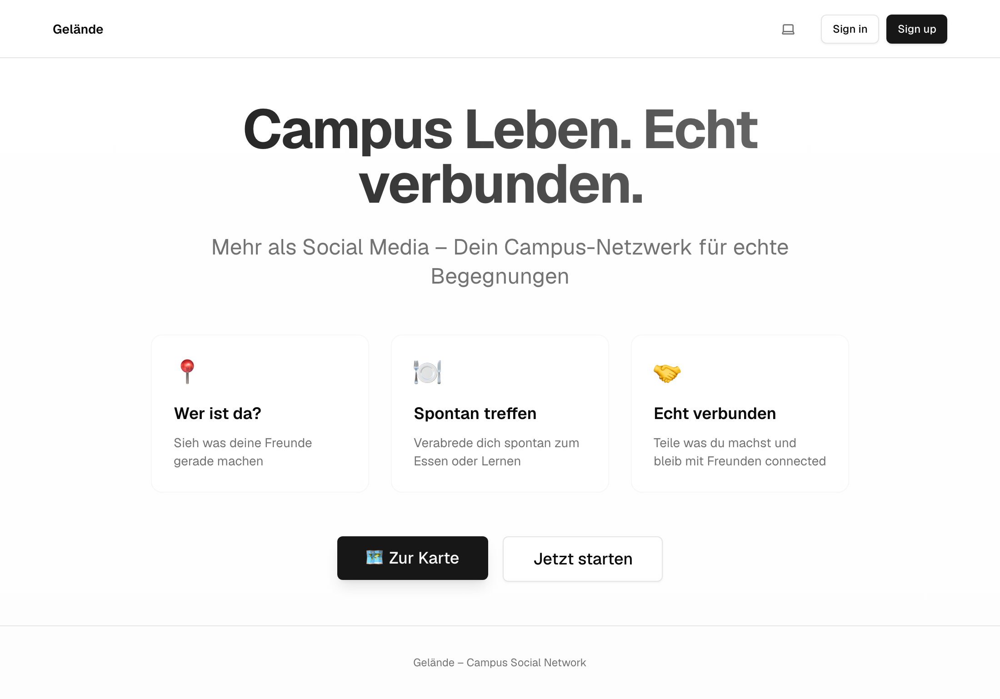
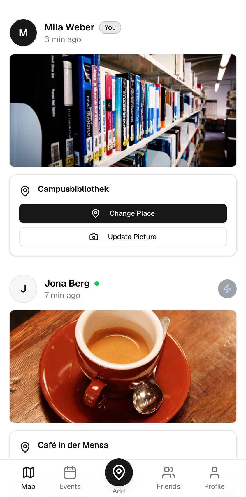
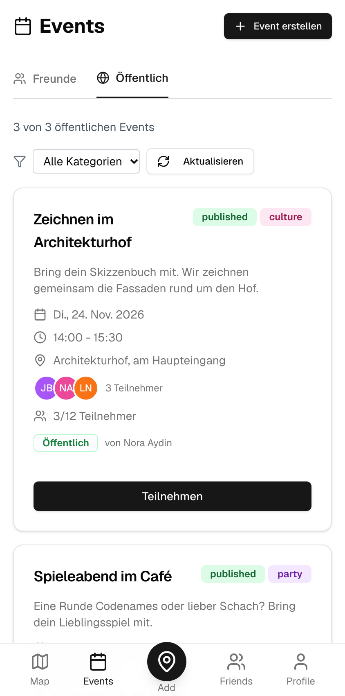

# Gelände

Gelände helps students meet up between classes. See who last checked in at the library or the campus café, share a photo from your own spot, or find a campus event to join later in the day.

[Open Gelände](https://gelaende.vercel.app/)

<p align="center">
  <a href="docs/screenshots/landing.webp?raw=1">
    
  </a>
</p>

<table align="center">
  <thead>
    <tr><th width="50%">Campus check‑ins</th><th width="50%">Public events</th></tr>
  </thead>
  <tbody>
    <tr>
      <td>
        <a href="docs/screenshots/check-ins.webp?raw=1">
          
        </a>
      </td>
      <td>
        <a href="docs/screenshots/events.webp?raw=1">
          
        </a>
      </td>
    </tr>
  </tbody>
</table>

## Features

- **Campus check-ins.** Choose a place, add an optional photo, and revisit past check-ins on your profile.
- **Friends.** Search for classmates by name and send a friend request. Once connected, their latest check-ins appear in your feed.
- **Events.** Browse public events by category, see the time, place, and attendees, and mark yourself as going.

The app uses the Next.js App Router, TypeScript, and Tailwind CSS. Supabase handles email/password sign-in and stores the campus data in PostgreSQL.

## Run locally

The steps below use Node.js 24, pnpm 10, and a new Supabase project with the Data API enabled.

```sh
git clone https://github.com/daviidoff/gelaende.git
cd gelaende
pnpm install --frozen-lockfile
```

### Set up the database

1. In the SQL Editor for your new Supabase project, run each migration once, in ascending filename order. [Migration files](supabase/migrations)
2. Give students a place they can search for. Run this in the same SQL Editor to add a library.

   ```sql
   INSERT INTO public.places (place_id, name)
   VALUES ('550e8400-e29b-41d4-a716-446655440001', 'Universitätsbibliothek')
   ON CONFLICT (place_id) DO NOTHING;
   ```

### Connect the app

Create `.env.local` in the repository root. Use the project URL and the **publishable key** (or legacy **anon** key) from your Supabase project's Connect dialog.

```dotenv
NEXT_PUBLIC_SUPABASE_URL=https://your-project-ref.supabase.co
NEXT_PUBLIC_SUPABASE_ANON_KEY=your-public-key
```

```sh
pnpm dev
```

For a first local check-in, create a confirmed test user under **Authentication → Users** in Supabase. Sign in, create your profile, then choose **Add**, search for `Universitätsbibliothek`, and select it. You can take a photo or skip straight to your check-in feed. [Open the local app](http://localhost:3000)

### Email sign-up and password recovery

To let people sign up through the app, enable the Email provider in Supabase. Under **Authentication → URL Configuration**, set the Site URL to your app origin (`http://localhost:3000` for development). Add the full URLs for `/map` and `/auth/update-password` on that origin to the redirect allow list.

Set the links in the two email templates to use Gelände’s confirmation route. For sign-ups outside your Supabase team, configure an SMTP provider. [Supabase email delivery](https://supabase.com/docs/guides/auth/auth-smtp)

| Email template | Link target |
| --- | --- |
| Confirm signup | `{{ .SiteURL }}/auth/confirm?token_hash={{ .TokenHash }}&type=email&next=/map` |
| Reset password | `{{ .SiteURL }}/auth/confirm?token_hash={{ .TokenHash }}&type=recovery&next=/auth/update-password` |

## Deploy to Vercel

Prepare the production Supabase database using the steps above. The button imports this repository and prompts for the two public environment variables. Use the deployment’s HTTPS origin for the production Site URL and redirect URLs.

[](https://vercel.com/new/clone?repository-url=https%3A%2F%2Fgithub.com%2Fdaviidoff%2Fgelaende&env=NEXT_PUBLIC_SUPABASE_URL%2CNEXT_PUBLIC_SUPABASE_ANON_KEY&install-command=npx%20--yes%20pnpm%4010.18.3%20install%20--frozen-lockfile)

## Contributing

Run `pnpm lint` and `pnpm check-types` for static checks and `pnpm test` for the Jest suite. The optional pre-commit hook runs lint and type checks with Yarn. If you have Yarn installed, enable the hook with `git config core.hooksPath .githooks`.

Report bugs and suggest improvements in [Gelände issues](https://github.com/daviidoff/gelaende/issues).
